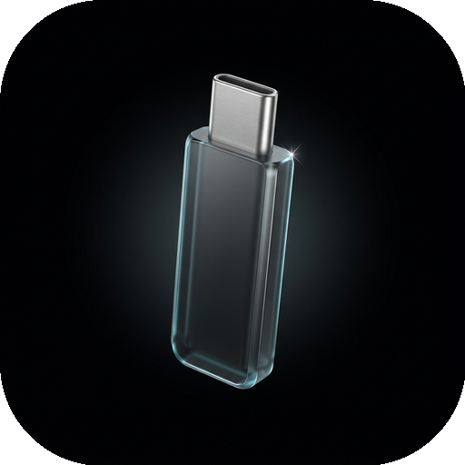
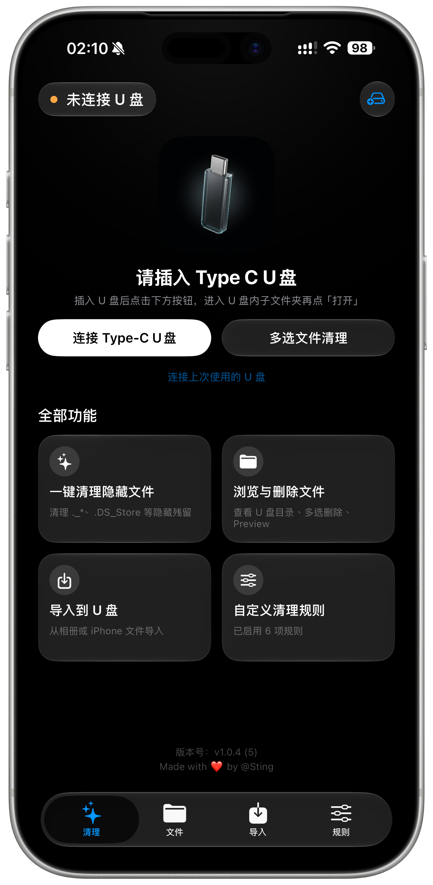
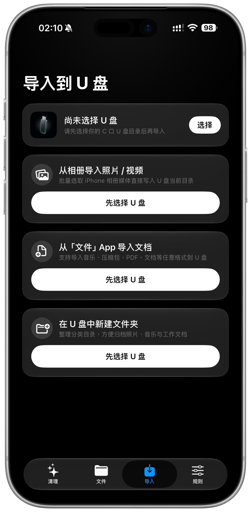
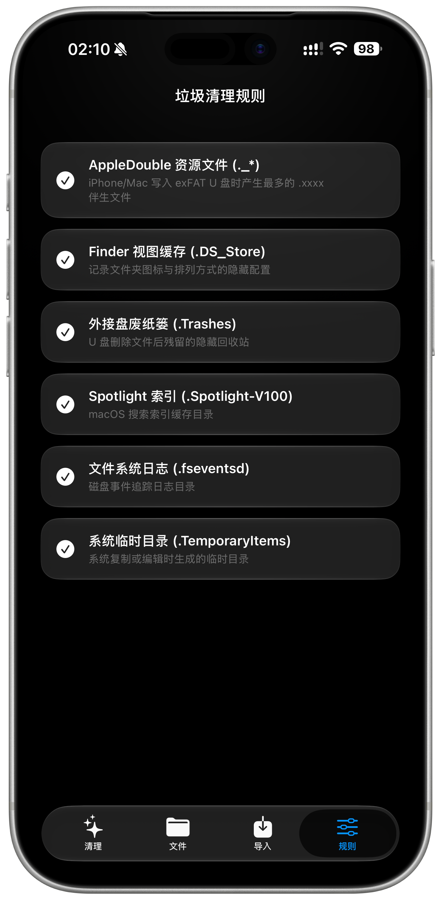

# USBuddy

**一款专为 iPhone / iPad（Type-C）打造的纯黑 Liquid Glass 风格外接 U 盘清理与管理工具**

iOS 26+ · iPadOS 26+

简体中文 · [English](README_EN.md)

[下载安装](#安装说明) · [界面预览](#界面预览) · [核心功能](#核心功能) · [编译指南](#方式一xcode-直接编译) · [开源协议](#开源协议)

---

主要解决 iPhone / Mac 向 FAT32 / exFAT U 盘写入文件后产生 `._*`、`.DS_Store` 等隐藏伴生文件导致**车载音响 / 车机无法识别或报错**的痛点，同时提供纯净写入、文件管理、重复文件查重与一键清理。

## 界面预览

  
  
  

## 核心功能

* **外接 Type-C U 盘挂载与容量统计**
  * 通过系统目录选择器挂载外接 U 盘，支持保存书签快捷重连、显示挂载路径与随时退出挂载。
* **一键清理 `.xxxx` 隐藏残留**
  * 精准扫描并清理 `._*`（AppleDouble）、`.DS_Store`、`.Trashes`、`.Spotlight-V100`、`.fseventsd`、`.TemporaryItems`。
  * 支持在「规则」页自定义勾选需要清理的类别。
* **重复文件识别与清理**
  * **相似文件名**：自动识别 `xxx 2`、`xxx2`、`xxx (1)`、`xxx（2）`、`xxx 副本` 等重复命名文件。
  * **内容相同**：按体积 → 首尾采样 → 全量 `SHA-256` 三段式精确比对，智能保留原文件，一键清理多余副本。
* **纯净导入与同名冲突处理**
  * 支持从「相册」或「文件」App 批量导入到 U 盘当前目录，自动清除伴生 `._*` 文件。
  * 导入出现同名文件时，支持逐个或批量选择「保留原文件 / 保留新文件 / 两个都保留」。
* **内置 U 盘文件浏览器**
  * 支持目录面包屑导航、搜索、排序（名称 / 大小 / 修改时间）、多选删除、重命名、新建文件夹、QuickLook 原生预览与导出分享。

---

## 环境要求

* **系统要求**：iOS / iPadOS 26.0+
* **开发工具**：Xcode（Swift 6.0 / SwiftUI，无任何第三方依赖）

---

## 安装说明

### 方式一：Xcode 直接编译
1. 克隆仓库后使用 Xcode 打开 `USBuddy.xcodeproj`。
2. 在 Target `USBuddy` 的 **Signing & Capabilities** 中选择你自己的 Apple 开发者账号并修改 Bundle Identifier。
3. 连接支持 Type-C 的 iPhone / iPad 直接运行安装。

### 方式二：使用未签名包自签（Sideload）
前往 [GitHub Releases](https://github.com/Stingraphic/USBuddy/releases) 下载最新 `USBuddy_Unsigned.ipa`，通过 AltStore / SideStore / 个人签名工具签名安装。

> **权限说明**：由于 iOS 外接 U 盘访问依赖系统安全作用域授权（`UIDocumentPickerViewController`），自签时请确保签名所使用的 Bundle ID 与描述文件（`.mobileprovision`）及 Entitlements 完全一致，不要随意修改为与描述文件不匹配的 Bundle ID；若使用 LiveContainer 运行，请在容器设置中开启 `Fix File Picker` 与 `Use LiveContainer's Bundle ID`。

---

## 开源协议

本项目基于 [MIT License](LICENSE) 开源。

Made with ❤️ by [@Stingraphic](https://github.com/Stingraphic)
