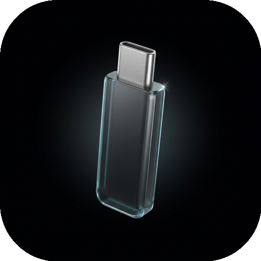
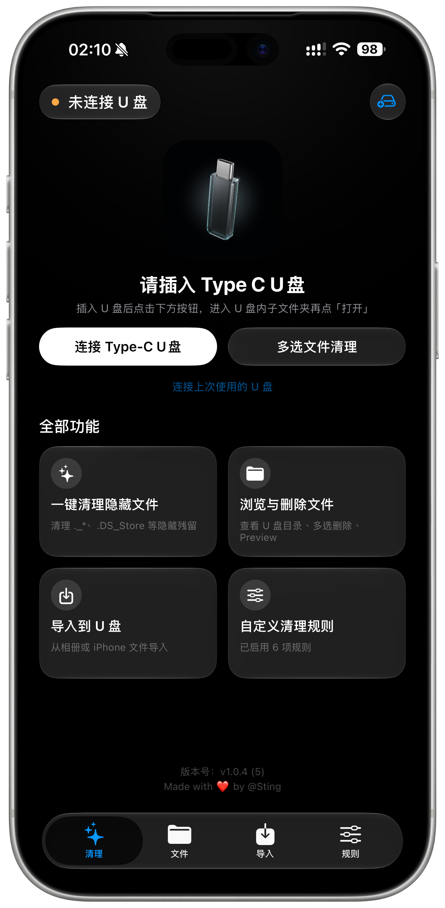
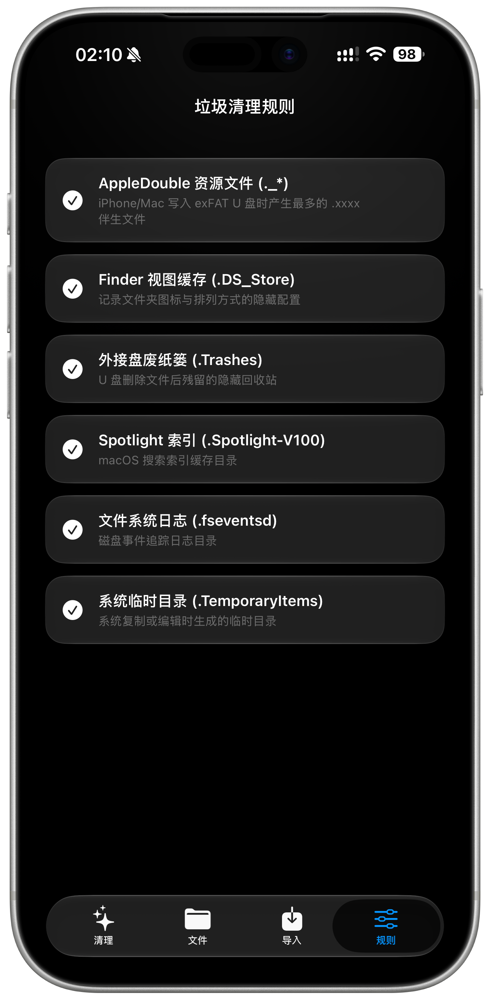

# USBuddy

**A pure-black Liquid Glass USB-C flash drive cleaner & file manager for iPhone and iPad**

iOS 26+ · iPadOS 26+

[简体中文](README.md) · English

[Download](#installation) · [Screenshots](#screenshots) · [Features](#features) · [Build from Source](#option-1-build-with-xcode) · [License](#license)

---

Designed to eliminate hidden macOS/iOS metadata files (`._*`, `.DS_Store`, etc.) on FAT32 / exFAT USB-C drives that often break car stereos and media players, while offering clean imports, duplicate detection, and full on-device file management.

## Screenshots

  
  
  

## Features

* **Type-C USB Drive Mounting & Storage Stats**
  * Mount external USB-C drives via the native system picker with persistent bookmark reconnection, mount path display, and one-tap unmount.
* **One-Tap Hidden Junk Cleanup**
  * Detects and removes `._*` (AppleDouble), `.DS_Store`, `.Trashes`, `.Spotlight-V100`, `.fseventsd`, and `.TemporaryItems`.
  * Customize enabled cleanup categories in the **Rules** tab.
* **Duplicate File Detection & Cleanup**
  * **Similar Filenames**: Automatically groups numbered/copy variants such as `song 2.mp3`, `song2.mp3`, `song (1).mp3`, `song（2）.mp3`, and `song copy.mp3`.
  * **Exact Content Match**: 3-stage verification (size → head/tail sample → full `SHA-256`) to safely remove redundant copies.
* **Clean Imports & Conflict Resolution**
  * Batch import from **Photos** or **Files** directly into the current USB folder while stripping `._*` sidecar files.
  * When filename conflicts occur, review and choose **Keep Existing**, **Keep New**, or **Keep Both** per file or in bulk.
* **Built-in File Browser**
  * Breadcrumb navigation, search, sorting (name / size / modified date), batch delete, rename, new folder, QuickLook preview, and share/export.

---

## Requirements

* **OS**: iOS / iPadOS 26.0+
* **Toolchain**: Xcode (Swift 6.0 / SwiftUI, zero third-party dependencies)

---

## Installation

### Option 1: Build with Xcode
1. Clone the repository and open `USBuddy.xcodeproj` in Xcode.
2. Select your Apple Developer team under **Signing & Capabilities** for the `USBuddy` target and set your own Bundle Identifier.
3. Connect a USB-C iPhone / iPad and build & run.

### Option 2: Sideload Unsigned IPA
Download `USBuddy_Unsigned.ipa` from [GitHub Releases](https://github.com/Stingraphic/USBuddy/releases) and sign it with AltStore, SideStore, or your preferred signing tool.

> **Permissions Note**: External USB drive access on iOS relies on `UIDocumentPickerViewController` security-scoped URLs. When sideloading, make sure your Bundle ID matches your `.mobileprovision` profile and entitlements. If running inside LiveContainer, enable both `Fix File Picker` and `Use LiveContainer's Bundle ID`.

---

## License

Released under the [MIT License](LICENSE).

Made with ❤️ by [@Stingraphic](https://github.com/Stingraphic)
